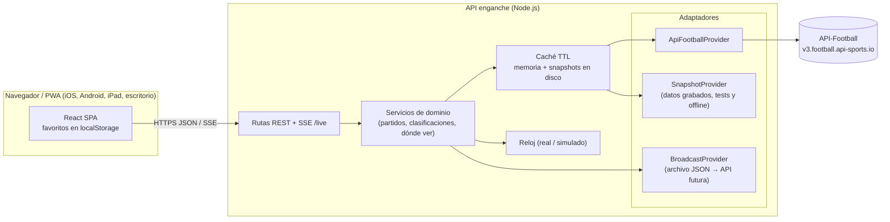

# TRD — enganche

## 1. Arquitectura



**Principios:**
- El navegador **solo** habla con nuestra API. La API key del proveedor nunca llega al cliente.
- El dominio usa **tipos propios** (`Match`, `Team`, `Competition`, `Standing`, `MatchEvent`, `Lineup`, `MatchStats`, `Broadcast`). Los adaptadores traducen el formato de cada proveedor a estos tipos. Así, cambiar de plan o de proveedor (R1, Q2 del PRD) solo afecta a un adaptador.
- **Reloj simulado:** el servidor tiene un `Clock` que en desarrollo se desplaza a una fecha de la temporada 2024. El dominio pregunta "qué es hoy" al `Clock`, nunca a `Date.now()`, y la respuesta se reproyecta a la fecha actual. Así la interfaz se comporta como en una temporada en curso.

## 2. Stack y justificación
| Capa | Tecnología | Por qué |
|---|---|---|
| Monorepo | npm workspaces: `apps/web`, `apps/api`, `packages/shared` | Tipos de dominio compartidos entre front y back; sin herramientas extra |
| Lenguaje | TypeScript (estricto) | Un mismo lenguaje en todo el proyecto; los tipos del dominio actúan como contrato |
| Frontend | React + Vite | SPA rápida, ecosistema amplio para PWA y gran demanda en portafolio |
| Datos en el cliente | TanStack Query | Caché, reintentos y refetch; los datos en vivo llegan por SSE |
| Rutas | React Router | Rutas `/`, `/competicion/:id`, `/partido/:id`, `/equipos` |
| Estilos | Tailwind CSS | Responsive rápido y modo oscuro |
| i18n | i18next + react-i18next | Español e inglés con detección del idioma del navegador (F8) |
| Fechas | `Intl.DateTimeFormat` + date-fns | Conversión de UTC a la zona del dispositivo sin dependencias pesadas |
| PWA | vite-plugin-pwa (Workbox) | Instalación, manifest y caché offline (F9) |
| Backend | Node.js 24 LTS + Fastify | Ligero, rápido y con validación por esquemas. No hace falta un framework pesado para una API que agrega datos y los cachea |
| Validación | Zod (en `packages/shared`) | Valida las respuestas del proveedor y la configuración |
| Tiempo real | Server-Sent Events (SSE) | Las actualizaciones van solo del servidor al cliente; es más simple que WebSocket y funciona detrás de proxies |
| Tests | Vitest, Testing Library, MSW, Playwright | Unitarios, de componentes, con API mockeada y e2e |
| Calidad | ESLint + Prettier, GitHub Actions | CI con lint, typecheck, tests y build |
| Base de datos | **Ninguna en el MVP** | Los favoritos viven en el cliente y los datos vienen del proveedor. Se añadirá PostgreSQL en la fase 2 (cuentas) |

## 3. Modelo de datos

**Tipos de dominio** (`packages/shared/src/domain.ts`), en resumen:
- `Competition { id, name, country, logo, type: 'league'|'cup', section: 'leagues'|'international', season }`
- `Team { id, name, shortName, logo, country }`
- `Match { id, competitionId, round, kickoffUtc, status: 'scheduled'|'live'|'halftime'|'finished'|'postponed'|'cancelled', minute?, home, away, score, venue? }`
- `MatchEvent { minute, extra?, type: 'goal'|'own_goal'|'penalty'|'card_yellow'|'card_red'|'sub'|'var', teamId, player, assist? }`
- `Lineup { teamId, formation, coach, starters[], bench[] }`
- `MatchStats { teamId, possession, shots, shotsOnTarget, corners, fouls, offsides, yellow, red, xg? }`
- `StandingRow { rank, team, played, won, drawn, lost, gf, ga, gd, points, form, group? }`
- `Broadcast { country, channel, platform?, url? }`

**Favoritos en el cliente** (`localStorage`, clave `enganche:favorites`):
```json
{ "version": 1, "teams": [{"id": 1137, "name": "Atlético Nacional"}], "competitions": [239] }
```
El campo `version` permite migrar los favoritos a una cuenta en la fase 2.

**Competiciones soportadas** (`apps/api/config/competitions.json`). IDs y temporada **confirmados por el spike HU-002** el 2026-10-29 (`jelt/spikes/api-football-cobertura.md`):
| Sección | Competición | Nombre en API-Football | ID | Temporada dev |
|---|---|---|---|---|
| Ligas | Liga BetPlay (Colombia) | Primera A | 239 | 2024 |
| Ligas | Liga Profesional Argentina | Liga Profesional Argentina | 128 | 2024 |
| Ligas | Serie A | Serie A (Italy) | 135 | 2024 (24/25) |
| Ligas | Premier League | Premier League | 39 | 2024 (24/25) |
| Ligas | LaLiga | La Liga | 140 | 2024 (24/25) |
| Ligas | Brasileirão Série A | Serie A (Brazil) | 71 | 2024 |
| Internacionales | Copa Libertadores | CONMEBOL Libertadores | 13 | 2024 |
| Internacionales | Copa Sudamericana | CONMEBOL Sudamericana | 11 | 2024 |
| Internacionales | UEFA Champions League | UEFA Champions League | 2 | 2024 (24/25) |
| Internacionales | UEFA Europa League | UEFA Europa League | 3 | 2024 (24/25) |

- **Plan Free (confirmado):** temporadas **2022–2024**, según el mensaje literal de la API: *"Free plans do not have access to this season, try from 2022 to 2024"*. Límites: 100 peticiones al día y unas 10 por minuto. La temporada actual de la API es 2026, bloqueada en Free.
- **Cobertura 2024:** las 10 competiciones declaran eventos, alineaciones, estadísticas de partido y clasificación.
- **Nombres:** se muestran nuestros nombres comerciales (por ejemplo "Liga BetPlay", "Brasileirão"), no los de la API. Dos competiciones se llaman "Serie A" en la API.

**Dónde ver** (`apps/api/data/broadcasts.json`):
```json
{
  "updated": "2026-10-29",
  "rules": [
    { "competitionId": 239, "country": "CO", "channels": [{"channel": "Win Sports", "platform": "Win Play"}] }
  ],
  "overrides": [
    { "matchId": 123456, "country": "CO", "channels": [{"channel": "Caracol TV"}] }
  ]
}
```
Países: CO (por defecto), AR, MX, CL, PE, EC y US. Un override de partido sustituye a la regla de su competición.

## 4. Integraciones externas

### API-Football (api-sports.io)
- **Autenticación:** cabecera `x-apisports-key` con el valor de la variable de entorno `API_FOOTBALL_KEY`.
- **Plan:** Free, con unas 100 peticiones al día y solo temporadas pasadas (R1).
- **Endpoints:**
  - `/fixtures` (por liga, temporada y fecha, o por `id`)
  - `/fixtures/events`, `/fixtures/lineups`, `/fixtures/statistics`
  - `/standings`
  - `/teams`
  - `/status` (cuota restante)
- **Estrategia de cuota.** Es crítica, porque 100 peticiones al día se agotan rápido:
  1. **Snapshots en disco** (`apps/api/.cache/`, no versionado). La primera respuesta a cada petición se guarda y en desarrollo se reutiliza indefinidamente. Los datos de 2024 ya no cambian, así que no hace falta volver a pedirlos.
  2. **Script de precarga** (`npm run seed`): descarga de forma controlada lo necesario para la demo (calendarios, clasificaciones y fichas completas de unas pocas jornadas por liga) respetando un presupuesto diario configurable. Se puede reanudar al día siguiente.
  3. **Caché en memoria** con TTL por tipo de dato, para producción con un plan premium:

     | Dato | TTL |
     |---|---|
     | Partido en vivo | 15–30 s |
     | Partidos del día | 5 min |
     | Clasificaciones | 1 h |
     | Equipos y competiciones | 24 h |

  4. **Protección:** si `/status` indica menos de un 10 % de cuota, la API sirve solo desde caché y lo anota en el log.
- **Si el proveedor falla:** se sirve el último dato cacheado con `stale: true` y su `updatedAt`. La interfaz muestra "Actualizado hace X min".
- **Fixtures de test:** `SnapshotProvider` lee los JSON grabados en `apps/api/test/fixtures/`, que sí se versionan. Los tests nunca llaman a la API real.

### Reloj simulado
- `CLOCK_MODE=simulated` y `SIM_ANCHOR=2024-11-09T18:00:00Z` hacen que el servidor trate esa fecha como "ahora". El reloj avanza en tiempo real desde que arranca el proceso.
- Las fechas de los partidos se **reproyectan**: `kickoffUtc + (ahora_real − SIM_ANCHOR)`. Así la interfaz muestra "hoy" y "mañana" con fechas actuales.
- **Partido en vivo simulado:** si un partido de 2024 está "en curso" según el reloj simulado, se calcula el minuto y se filtran los eventos hasta ese minuto. Esto permite probar F3 y F5 en vivo sin un plan premium.
- `CLOCK_MODE=real` en producción con un plan premium.

### Dónde ver
- `BroadcastProvider` es una interfaz. La implementación del MVP es `FileBroadcastProvider`, que lee `broadcasts.json`.
- Más adelante se podrá añadir `SportmonksBroadcastProvider` u otro proveedor con datos de TV (objetivo de la decisión Q2 del PRD).

## 5. Contratos de API propios
Todas las respuestas son JSON con la forma `{ data, meta: { updatedAt, stale, source } }`.

| Método y ruta | Descripción | Cubre |
|---|---|---|
| `GET /api/competitions` | Competiciones soportadas, agrupadas por sección | F1 |
| `GET /api/competitions/:id/matches?round=` o `?from=&to=` | Partidos de una competición | F4 |
| `GET /api/competitions/:id/standings` | Clasificación (grupos incluidos) | F6 |
| `GET /api/teams/search?q=` | Búsqueda de equipos en las competiciones soportadas | F2 |
| `GET /api/my-matches?teams=1,2&competitions=39,239&from=&to=` | Partidos de los favoritos (en vivo, hoy, próximos, recientes) | F3 |
| `GET /api/matches/:id` | Ficha: partido, eventos, alineaciones y estadísticas | F5 |
| `GET /api/matches/:id/broadcasts?country=CO` | Dónde ver | F7 |
| `GET /api/live?matches=1,2` (SSE) | Envía `match.update` cuando cambia el marcador, el minuto, el estado o los eventos | F3, F5 |
| `GET /api/health` | Estado, modo del reloj y cuota restante | Operación |

Los favoritos se envían como parámetros de consulta porque el servidor no tiene estado de usuario en el MVP.

## 6. Seguridad y gestión de secretos
- `API_FOOTBALL_KEY` vive solo en `apps/api/.env`, que no se versiona. Se incluye un `.env.example` sin valores.
- CORS restringido al origen del frontend.
- Rate limit por IP en nuestra API (`@fastify/rate-limit`) para que nadie agote la cuota del proveedor.
- Todos los parámetros de entrada se validan con Zod. Los IDs de competición deben pertenecer a la lista soportada.
- Cabeceras de seguridad con `@fastify/helmet`. No hay datos personales en el MVP.

## 7. Estrategia de pruebas
| Nivel | Herramienta | Qué cubre |
|---|---|---|
| Unitario (shared/api) | Vitest | Mapeo proveedor → dominio, reloj simulado, reglas de dónde ver, TTL de caché |
| Integración (api) | Vitest + `fastify.inject` + SnapshotProvider | Contratos de la sección 5 |
| Componentes (web) | Vitest + Testing Library + MSW | Pantallas, estados vacíos, i18n, conversión de zona horaria |
| E2E | Playwright (Chromium, WebKit, viewport móvil y tablet) | Flujos clave: elegir favoritos → portada → ficha |

- **Líneas `Verify:`** de las historias. Cada AC apunta a un test con nombre `AC<n>`. Ejemplo: `npm test -w apps/web -- favorites -t "HU-004 AC1"`.
- **Cobertura mínima:** 80 % de líneas en `apps/api/src/domain` y `packages/shared`.
- **Zona horaria:** los tests fijan `TZ=America/Bogota` y también se ejecutan con otra zona para detectar errores de conversión.

## 8. Entornos, CI/CD y despliegue
### Ramas y ambientes
| Rama | Ambiente | Para qué | Entra por |
|---|---|---|---|
| `feat/HU-xxx-*`, `fix/BUG-xxx-*` | Local | Desarrollo de una historia o bug | Se crea desde `develop` |
| `develop` | Desarrollo | Integración continua del equipo; demo interna | PR desde ramas de historia (CI en verde) |
| `staging` | Pruebas (QA / externos) | Validación con el BA y usuarios externos antes de publicar | PR `develop → staging` al cerrar un conjunto de historias |
| `main` | Producción | Versión publicada | PR `staging → main` tras la validación; se etiqueta la versión (`vX.Y.Z`) |

- Las correcciones urgentes de producción salen de `main` (`hotfix/*`), vuelven a `main` por PR y después se integran en `staging` y `develop`.
- Una historia pasa a `done` cuando su PR se fusiona en `develop` con el CI en verde. Su paso por `staging` y `main` se registra en el comentario de Jira de la versión.
- **Limpieza de ramas:** GitHub borra automáticamente la rama de origen al fusionar una PR. `develop`, `staging` y `main` están protegidas contra el borrado, así que las PR de promoción no las eliminan.
- **Protecciones:** `main` y `staging` exigen PR con el check `quality` en verde, sin push directo ni force-push, también para administradores. `develop` admite push directo, pero no borrado ni force-push.

### Pipeline
- **Local:** `npm run dev` arranca la web (Vite, :5173) y la API (:3000) con un proxy `/api`. El reloj es simulado y los datos salen de snapshots.
- **CI (GitHub Actions):** install → lint → formato → typecheck → test → build en cada PR y push a `develop`, `staging` y `main`. Playwright se ejecuta desde `staging`.
- **Despliegue por rama** (cuando se elija proveedor): `develop` → ambiente de desarrollo, `staging` → ambiente de pruebas con URL compartible, `main` → producción.
- **Despliegue de demo (portafolio):**
  - Frontend en Cloudflare Pages o Vercel, en plan gratuito.
  - API en Render o Fly.io, en plan gratuito o de bajo coste.
  - La demo usa el reloj simulado y los snapshots, sin consumir cuota.
  - El proveedor se decidirá al cerrar la épica de PWA.
- **Apps nativas (fase 3):** Capacitor sobre `apps/web`.

## 9. Decisiones de arquitectura (ADR)
| # | Decisión | Alternativas | Motivo |
|---|---|---|---|
| ADR-1 | React + Vite | Angular, Next.js | SPA sin necesidad de SSR. Más ágil para un desarrollador solo y fácil de empaquetar con Capacitor después |
| ADR-2 | Fastify (Node) | NestJS, .NET, PHP | Comparte TypeScript con el front. Es una API pequeña que agrega datos, así que NestJS sobraría |
| ADR-3 | Capa de adaptadores para datos y TV | Llamar al proveedor directamente | R1 y Q2: el proveedor y el plan van a cambiar |
| ADR-4 | Snapshots en disco y precarga | Solo caché en memoria | El límite de 100 peticiones al día no permite desarrollar llamando a la API |
| ADR-5 | Reloj simulado con reproyección de fechas | Mostrar fechas de 2024 tal cual | Permite diseñar y probar "hoy" y "en vivo" con datos gratuitos |
| ADR-6 | SSE para el tiempo real | WebSocket, polling desde el cliente | Las actualizaciones van en un solo sentido y es más simple de operar |
| ADR-7 | Sin base de datos en el MVP | PostgreSQL desde el inicio | No hay usuarios ni datos propios aún. Se añadirá en la fase 2 |
| ADR-8 | Canales en un JSON versionado | Panel de administración | Decisión Q2 del PRD |
| ADR-9 | Ramas `develop` → `staging` → `main` (un ambiente cada una) | Trunk-based con solo `main` | Separar desarrollo, pruebas con externos y producción, a petición del usuario |
